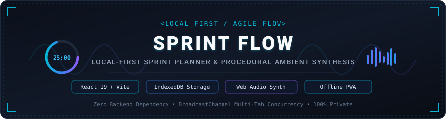
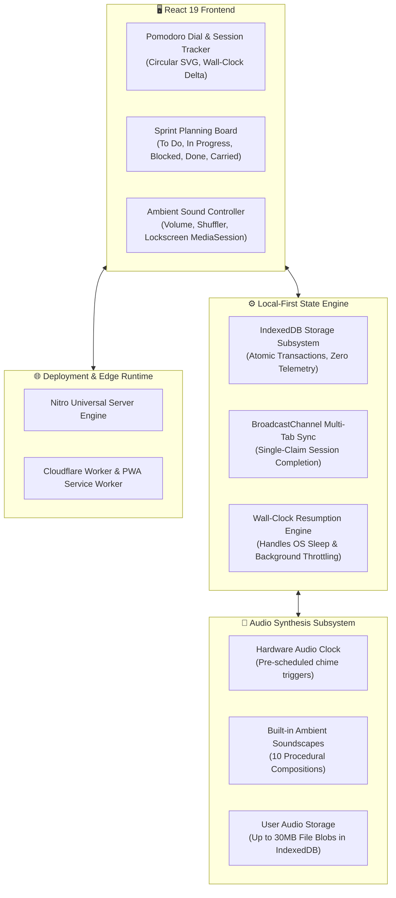

<p align="center">
  
</p>

<p align="center">
  <a href="https://github.com/Rithikasri-code/sprint-flow"></a>
  
  
  
  
  
  
</p>

---

## ⚡ Overview

**SprintFlow** is a high-performance, local-first sprint planning and deep-work execution engine featuring procedural ambient soundscapes. Built with **React 19**, **TypeScript**, **Vinext / Vite**, **Nitro**, and **IndexedDB**, SprintFlow eliminates backend latency, accounts, telemetry, and external cloud dependencies.

All state—sprint cycles, Pomodoro logs, task dependency trees, and audio streams—lives entirely on the client within persistent IndexedDB transactions, synchronized seamlessly across multiple browser tabs via `BroadcastChannel`.

---

## 🏗️ Architecture & Data Flow



---

## 🚀 Key Engineering Highlights

### 1. **Robust Background Resumption (No Drift)**
Browser tabs are aggressively throttled or suspended by modern operating systems. Rather than relying on fragile `setInterval` ticks:
- SprintFlow binds all timers to **wall-clock UTC target timestamps**.
- Upon document focus or wake event, the reconciliation engine computes exact delta elapsed time, preventing runaway fictitious sessions.
- Timed alarms are pre-scheduled directly onto the hardware **Web Audio API clock**, firing on time even during CPU throttling.

### 2. **Multi-Tab Concurrency via `BroadcastChannel`**
- Multiple open tabs share state via transactional locks and event broadcasting.
- When a timer completes in one tab, an atomic IndexedDB transaction claims the completion record exactly once, preventing duplicate notifications across windows.

### 3. **Autonomous Sprint Cycles**
- Supports Daily, Weekly, Fortnightly, and Calendar-Month sprints with sticky day-of-month anchoring.
- Intelligent rollover handles incomplete tasks upon crossing midnight, with single-click options to carry forward or cleanly abandon with audit retention.

### 4. **Privacy-Preserving Offline PWA**
- Complete Service Worker caching for instant offline boots.
- Encrypted or raw JSON backup/restore mechanics for portable state migration.

---

## 💻 Developer Quickstart

### Prerequisites
* **Node.js 22+ or 24+**
* **npm**

### Development Mode
```bash
# Clone the repository
git clone https://github.com/Rithikasri-code/sprint-flow.git
cd sprint-flow

# Install pinned dependencies
npm ci

# Boot local Vite development server
npm run dev
```
Navigate to `http://localhost:4317` to launch the application.

---

## 🧪 Testing & Verification

SprintFlow comes with automated verification scripts and tests:

```bash
# Run unit & integration test suites
npm test

# Static type checking
npm run typecheck

# Code quality & formatting
npm run lint
npm run format

# Production build preview
npm run build:preview
PORT=4173 npm start
```

---

## 🌐 Cloudflare Workers Deployment

SprintFlow compiles directly to a Cloudflare Worker via Nitro:

```bash
# Build production bundle
npm run build

# Deploy to Cloudflare Workers
npx wrangler deploy
```

---

## 📄 License

Distributed under the **MIT License**.
